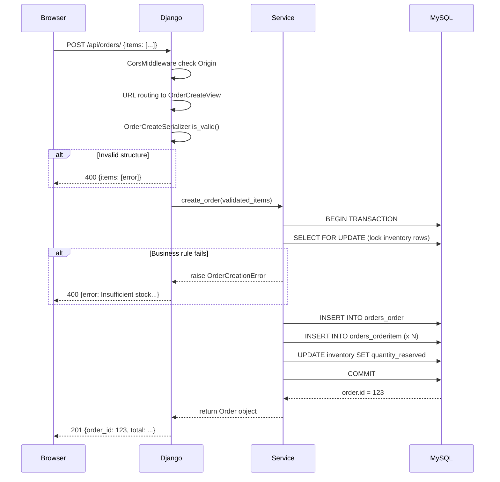

# Architecture — Django E-Commerce Logistics Engine

Current architecture (implemented and tested) vs planned (not yet built).

---

## Current Architecture (Implemented and Tested)

Request flow for POST /api/orders/:

```
React (not yet built)
  | HTTP POST /api/orders/ JSON
  v
[ Django 6.1 WSGI application ]
  |
  v
[ Middleware Pipeline ]
  SecurityMiddleware
  SessionMiddleware
  CorsMiddleware (checks Origin, adds CORS headers)
  CommonMiddleware
  CsrfViewMiddleware
  AuthenticationMiddleware
  XFrameOptionsMiddleware
  |
  v
[ URL Routing ]
  config/urls.py -> path(api/orders/, include(orders.urls))
  orders/urls.py  -> path('', OrderCreateView.as_view())
  |
  v
[ OrderCreateView ] orders/views.py
  1. DRF parses JSON to Python dict
  2. Validate with OrderCreateSerializer
     Invalid -> 400 with serializer.errors
  3. Call create_order(validated_items)
     OrderCreationError -> 400 {error: ...}
     Unexpected -> 500 (not caught)
  4. Build response dict from Order object
  5. Return Response(data, status=201)
  |
  v
[ OrderCreateSerializer ] orders/serializers.py
  Validates: non-empty items, positive integers, no duplicates
  Extra fields (unit_price from client) silently ignored
  |
  v
[ create_order() ] orders/services.py
  validate_order_items() -> pure Python
  with transaction.atomic():
    SELECT ... FOR UPDATE (lock rows, ordered by product_id)
    Check: product active, stock sufficient, inventory exists
    Order.objects.create(status=PENDING)
    OrderItem.objects.create(unit_price=product.price snapshot)
    inventory.quantity_reserved += quantity
    return order
  |
  v
[ Django ORM -> MySQL/InnoDB ]
  INSERT INTO orders_order ...
  INSERT INTO orders_orderitem ...
  UPDATE inventory_inventory SET quantity_reserved = ...
  COMMIT (or ROLLBACK on any exception)
```

---

## Vertical Slice Architecture

Each feature owns its complete slice from HTTP to database.
No shared base views or generic service mixins.

Feature: Order Creation
- orders/urls.py        URL routing
- orders/views.py       HTTP handling
- orders/serializers.py Input validation
- orders/services.py    Business logic + transaction
- orders/models.py      Data + ORM
- orders/tests.py       All test types

Feature: Inventory (read-only from order perspective)
- inventory/models.py   Product + Inventory
- inventory/migrations/  Schema

Why: View knows HTTP, not MySQL. Service knows business rules, not HTTP.
Service can be tested without HTTP. Adding a feature means adding a slice.

---

## Data Models

Product: id, name, sku (unique), price, is_active, created_at
Inventory: id, product (1:1 PROTECT), quantity_on_hand, quantity_reserved
  [property] available_quantity = on_hand - reserved
  [constraint] reserved_lte_on_hand: reserved <= on_hand
Order: id, status (pending/confirmed/cancelled), created_at, updated_at
OrderItem: id, order (FK CASCADE), product (FK PROTECT), quantity, unit_price
  [property] line_total = quantity * unit_price
  [constraint] quantity > 0, unit_price >= 0

Relationships:
- One Product -> one Inventory (OneToOneField)
- One Order -> many OrderItems (order.items.all())
- One Product -> many OrderItems (across different orders)

---

## Transaction and Concurrency Design

Two concurrent requests for product_id=5 (stock=1):

T1 Request A: BEGIN, SELECT FOR UPDATE -> locks row
T2 Request B: BEGIN, SELECT FOR UPDATE -> BLOCKED (waits for lock)
T3 Request A: Creates order, reserves 1 unit, COMMIT -> releases lock
T4 Request B: Lock acquired, reads available=0, raises OrderCreationError
T5 Request B: ROLLBACK

order_by(product_id) ensures both transactions lock in same order -> no deadlocks.

---

## Request/Response Flow (Mermaid)



---

## Planned Architecture (Not Yet Built)

### JWT Authentication (Stage 7)

Browser -> POST /api/auth/token/ {username, password}
       <- 200 {access: jwt, refresh: jwt}

Browser -> POST /api/orders/ with Authorization: Bearer jwt
       -> Django JWTAuthentication decodes token
       -> Sets request.user
       -> View checks request.user.is_authenticated
       <- 401 if missing/invalid token, 201 if valid

JWT authenticates WHO is making the request.
select_for_update() still handles concurrent stock reservation.
JWT does NOT replace database locking.

### Celery + Redis Background Task Flow (Stage 8)

Inside transaction.atomic():
  Order saved to MySQL
  transaction.on_commit(lambda: send_order_confirmation.delay(order.id))

COMMIT (transaction completes)
  -> on_commit callback fires
  -> send_order_confirmation.delay(order.id) publishes to Redis queue
  -> Celery worker picks up task
  -> Worker reads Order from MySQL by order.id
  -> Sends confirmation email

If task fails -> Celery retries with exponential back-off
If task delivered twice -> idempotency key prevents duplicate email

Why transaction.on_commit(): If the task is dispatched before commit
and the transaction rolls back, the task fires for an order that does
not exist. on_commit() ensures the task only runs after data is saved.

---

## Dependency Map (Python imports)

config/urls.py
  -> orders/urls.py
    -> orders/views.py
      -> orders/serializers.py
      -> orders/services.py
        -> orders/models.py
        -> inventory/models.py

---

## Architectural Decisions

ADR-1: Service Layer Separation
  Decision: Business logic in services.py, not in the view.
  Reason: View handles HTTP. Service handles rules. Separable and testable.
  Trade-off: More files. Worth it for testability.

ADR-2: MySQL/InnoDB for Row-Level Locking
  Decision: Use MySQL instead of SQLite.
  Reason: select_for_update (FOR UPDATE) is only meaningful in InnoDB.
  Trade-off: Requires MySQL running locally.

ADR-3: Price Snapshot on OrderItem
  Decision: Copy Product.price into OrderItem.unit_price at creation.
  Reason: Prices change. Historical orders must show price paid.
  Trade-off: Redundant data. Correct for accounting and auditing.

ADR-4: Connection Pooling
  Decision: Use dj_db_conn_pool with pool size 10.
  Reason: Opening MySQL connections per request is expensive.
  Trade-off: Connections shared. Pool exhaustion possible under extreme load.

ADR-5: Vertical Slice Architecture
  Decision: Each feature owns its full slice from URL to database.
  Reason: Avoids premature abstraction. Independently testable.
  Trade-off: Some duplication. Acceptable until patterns are clear.

---

## Known Gaps and Risks

| Gap | Risk | Mitigation |
|---|---|---|
| No JWT authentication | Any client can create orders | Planned for Stage 7 |
| Concurrency not stress-tested | Locking correct but unverified under load | Threading test planned |
| SECRET_KEY has insecure fallback | Security risk if deployed without env var | Remove fallback before production |
| No order list or detail endpoint | Frontend cannot show order history | Required for Stage 6 |
| test_views.py is broken | Misleading file in repo | Replace in Stage 6 |
| No rate limiting | Abuse risk on order endpoint | Add in Stage 9 |
